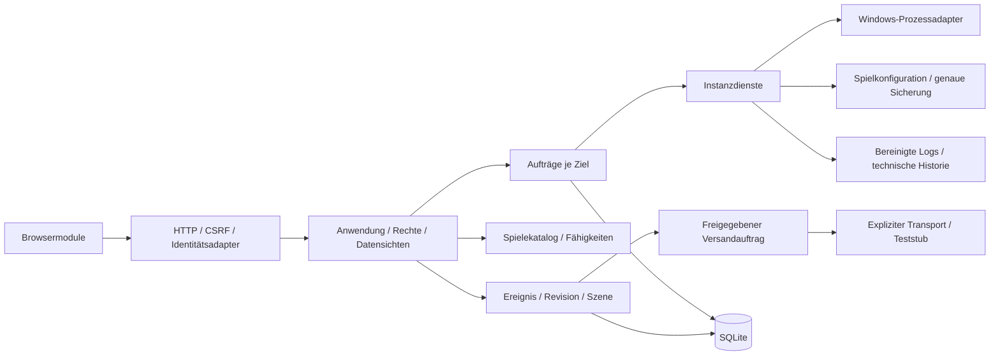

# Ausbauarchitektur und Refactoring #27

Stand: 15.10.2026. Die [Bewertungsmatrix](backlog.md) ordnet sämtliche bisherigen Issues und die neue Steam-Erkennung #29 ein. Die Fachfunktionen bleiben ihren Issues zugeordnet. Dieses Refactoring schafft ausführbare gemeinsame Grenzen, keine automatische Aktivierung von Fernzugriff, Modinstallation oder Errungenschaftserkennung.

## Entscheidungen

Den modularen Python-Dienst und HTML/CSS/JavaScript fortführen. Vier Spieler auf einem zugleich zum Spielen genutzten Windows-Rechner brauchen aktuell weder zusätzliche Serverdienste noch einen Frameworkwechsel. Python-Standardbibliothek inklusive SQLite genügt für diese Grundlagen; Playwright bleibt eine Entwicklungsabhängigkeit.



## Verantwortlichkeiten und Verträge

| Modul | Verantwortung |
| --- | --- |
| `server.py` | Loopback, Host/Origin, CSRF, JSON-Größenlimit, statische Dateiliste, HTTP-Fehler. |
| `api.py` | GET-/POST-Verträge und Parameterprüfung. Keine Windows- oder Versandlogik. |
| `application.py`, `security.py` | Identität, Rechte, gefilterte Datensichten, Auswahl einer ausdrücklichen Instanz, Operationsdispatch. |
| `registry.py`, `catalog.py` | Installationen und gemeinsame Einstellungen gegenüber eigenständigen Spielidentitäten/Fähigkeiten. |
| `instances.py` | Zusammensetzung genau einer Instanz. `core.py` erhält die bisherigen Importnamen als Kompatibilitätsfassade. |
| `instance_config.py`, `games.py` | Sicherung, atomarer Konfigurationswechsel und spielspezifisches Format/Validierung. |
| `operations.py`, `processes.py` | Lebenszyklus und native Prozesszuordnung. PowerShell-Skripte bleiben erhalten. |
| `instance_logs.py`, `logs.py`, `history.py` | Quellenwahl, Geheimnisbereinigung und begrenzte technische Verlaufssicht. |
| `discord.py` | Gemeinsame Webhook-Einstellungen und bestehender HTTP-Transport. ASKA behält seinen externen Starter. |
| `jobs.py`, `storage.py` | Begrenzte Ausführung, Sperren, dauerhaftes Ergebnis, versionierte Datenbank und konsistente Sicherung. |
| `community.py`, `prototype.py` | Ereignis-/Szenen-/Versandvertrag und ausschließlich temporärer ausführbarer Durchstich. |

Spiel-ID, Serverinstanz-ID und Kampagnen-ID sind unterschiedliche Schlüssel. Die bisherige Profil-ID ist die Instanz-ID; Weltwahl erzeugt keine zweite unabhängige Instanz mit derselben EXE. Eine Kampagne bezeichnet die dauerhafte Spielgeschichte, ein Weltordner deren spielabhängigen Speicherort. Ein Modprofil erhält eine eigene ID und künftig unveränderliche Revisionen. Es gehört zum Spiel und optional zu Instanz/Kampagne. `EventContext` enthält diese Referenzen getrennt; serverlose Spiele sind im Katalog und in Gemeinschaftsereignissen zulässig.

`catalog_games` in der bestehenden lokalen Managerdatei kann zusätzliche reine Spieleinträge enthalten, etwa `[{"id":"raft","label":"Raft"}]`. Dadurch wird kein Server- oder Modadapter behauptet. Nur vorhandene Spieladapter erscheinen in der Serverregistrierung. Fähigkeitszustände sind `supported`, `unsupported`, `unknown` mit Begründung. #5 ergänzt später die geprüften betrieblichen Quellen; #20 ergänzt unabhängige Quellenadapter mit Metadaten-/Downloadfähigkeiten. Eine Modquellen-ID ist weder Spiel-ID noch Dateiversion.

Mitglied, Anmeldung und Spielergerät ebenfalls unterscheiden: `Principal.id` bezeichnet den lokal verifizierten Akteur; `member_ids` hält den Mitgliederkreis eines Ereignisses fest. Steam-/Discord-Konten sind spätere bewusste Verknüpfungen. Ein Gerätezugang aus #21 erhält eine eigene Geräte-ID mit begrenztem, widerrufbarem Recht und wird kein Besitzer-Login. Kampagnen-, Mitglieder-, Modprofil- und Geräteverwaltung werden in ihren Fachissues ergänzt; dieses Refactoring erzeugt dafür keine erfundenen Konten oder laufenden Synchronisierungen.

## API und Rechte

`/api/session` nennt `api_version: 1`, CSRF-Token und die vom Server bestimmte Identität samt Rechten. Das Token ist keine Anmeldung. Die ausgelieferte Konfiguration bindet weiterhin ausschließlich `127.0.0.1` und akzeptiert die bisherigen localhost-Hosts/Origins. Der Identitätsadapter behandelt dabei den lokalen Zugriff als Besitzer und ignoriert eingehende Rollen-/Proxyheader. Tests injizieren Familien-/Leseridentitäten über die Serverkonstruktion. #17 ersetzt diesen Adapter erst durch geprüfte private Authentifizierung; keine Netzwerkfreigabe ist Teil dieses Refactorings.

| Vertrag | Inhalt / Recht |
| --- | --- |
| `GET /api/servers`, `/api/games` | Gefilterte Instanzen bzw. Spielidentitäten mit Fähigkeiten. Familien erhalten keine Installationspfade. |
| `GET /api/status?server=<id>` | Prozessstatus und ausdrücklich ausgewählte Anzeigegrößen; keine allgemeine Spielkonfiguration. |
| `POST /api/updates/check` | Besitzerrecht `updates.check`, `{server_id}`; Antwort 202 mit lesendem Steam-Prüfauftrag. Der begrenzte Befund steht unter `update` in `/api/status`. |
| `GET /api/config?server=<id>` | Konfiguration und Formularschema, nur Besitzer. ASKA-Geheimnisse bleiben leer. |
| `GET /api/events`, `/api/logs` | Technische Historie/bereinigte Logs, derzeit nur Besitzer. |
| `POST /api/jobs` | `{server_id, operation}` für Start/Stopp/Neustart; Antwort 202 mit unveränderlicher Auftrags-ID. Intern auch Setup/Konfigurationsänderung. |
| `GET /api/jobs?id=<id>` oder `?server=<id>` | Berechtigter Auftrag oder letzte 20 Aufträge der Instanz; Familien sehen keine Besitzerdiagnostik/Ergebnisdaten. |
| `GET /api/community` | Letzte 20 Ereignisse mit Revision, gleichen Auszeichnungen und stabiler Szene; Instanzfreigaben werden berücksichtigt. |

Bestehende POST-Routen und `/api/state` bleiben für den lokalen Besitzer kompatibel. Sie rufen dieselben Rechte und Instanzabläufe auf. `/api/state` enthält weiterhin Besitzerkonfiguration und ist für Familie gesperrt; das neue Frontend verwendet getrennte Sichten. Fehler tragen einen stabilen `code` (`forbidden`, `not_found`, `conflict`, `local_storage`) und einen deutschen Text. CSRF-/JSON-Transportfehler bleiben HTTP 4xx.

Besitzer dürfen konfigurieren und betreiben. Familien dürfen freigegebene Profile sehen und starten; Stoppen/Neustart bleiben bis zur verlässlichen Belegungsprüfung aus #14 gesperrt. Leser haben ausschließlich Leserechte. Unbekannte Rollen werden abgelehnt. Versteckte UI-Schaltflächen ersetzen diese Prüfungen nicht.

## Aufträge und Parallelität

Vier Worker, höchstens 16 aktive/wartende Ziele. Ein Ziel besitzt höchstens einen verändernden Auftrag. Konfiguration, Setup und Prozessaktionen verwenden dieselbe Instanzsperre; Discord hat ein eigenes Verwaltungsziel. Registrierung und gemeinsame Einstellungen teilen eine kurze Metadatensperre. Weder Windows-Aufrufe noch Discord-Netzwerkzugriffe halten diese globale Sperre. Lesender Status wartet nicht auf die Instanzsperre.

`steam.py` liest eindeutig zugeordnete Steam-Manifeste und begrenzt die anonyme SteamCMD-Abfrage. `updates.py` hält den versionierten Metadaten-Cache, Zustandsbewertung und sparsamen Zeitplan; [Details und Quellen](steam-updates.md). Ein lesender Prüfauftrag behält die echte Server-ID für Verlauf/Rechte und verwendet eine eigene Reservierung `('updates', server_id)`. Dadurch bleibt der verändernde Instanzauftrag unabhängig. Frontend-Pendingzustände unterscheiden diese beiden Reservierungen ebenfalls. Der Zeitplan startet nur im regulären `serve`-Einstieg; isolierte HTTP-/Browserfixtures lösen keine echten periodischen Abfragen aus.

Zustände: `queued → running → succeeded/failed`; nach unterbrochener Verwaltung `interrupted`. Der Fortschritt nennt die tatsächliche Phase und eine Arbeitseinheit, keine erfundene Prozentzahl für ein Spiel. Diese Operationen sind ausdrücklich weder abbrechbar noch fortsetzbar. Ein Neustart der Verwaltung wiederholt keinen unklar abgeschlossenen Stopp, Download oder Dateischritt. Prozessstatus und vorhandene bereinigte Logs dienen der anschließenden Prüfung. Spätere Sicherungs-/Update-/Downloadschritte können eigene ehrliche Fortschritts- und Wiederanlaufverträge erhalten.

Schlägt das Speichern eines Workerzustands vor oder nach dem eigentlichen Seiteneffekt fehl, wird das Ergebnis als unbekannt/unterbrochen geführt. Solange die Datenbank keine Änderung annimmt, hält die Verwaltung diese terminale Sicht im Speicher; der nächste mögliche Zugriff gleicht sie in SQLite ab. Der Callback wird nicht erneut ausgeführt. Ein Prozessneustart behandelt auch übrig gebliebene `queued`-/`running`-Einträge als unterbrochen.

## Frontend

| Modul | Verantwortung |
| --- | --- |
| `app.js` | Zusammensetzung, Auswahlwechsel, gezieltes Laden und Auslösen fachlicher Abläufe. |
| `api.js` | HTTP/CSRF und Fehler; jedes Instanzziel wird ausdrücklich übergeben. Kein Lesen einer veränderlichen globalen Auswahl im Client. |
| `state.js` | Eindeutige Quelle für Auswahlgeneration, Identität/Rechte, Entwürfe und laufende Aufträge. |
| `forms.js` | Schemabasierte Eingaben, JSON-Entwurf und Erhalt ungespeicherter Daten. |
| `navigation.js`, `dom.js` | Gemeinsame Navigation, sichere Textelemente und schließbare Meldungen. |
| `jobs.js` | Auftragsverfolgung, Phase/Ergebnis und getrennte Sperre je Ziel. |
| `views/server.js`, `views/logs.js` | Status/Historie und eine unabhängig gegen verspätete Antworten geschützte Logansicht. |
| `views/catalog.js`, `views/community.js` | Eigenständige Spielidentität/Fähigkeiten sowie Chronik mit stabiler Szenenzuordnung. |

Eine neue Auswahl verwirft alte Statusanfragen und erhöht eine Auswahlgeneration. Antworten und Konfigurations-/Loganforderungen prüfen ihre ursprüngliche Auswahl; sie ändern das Prozessziel nicht nachträglich. Ein abgelehnter Profilwechsel erhält den Entwurf. Navigation erhält auch Discord-/Nachrichten-/Registrierungsentwürfe. Verlassen mit ungespeicherten Daten wird angekündigt.

Discord- und Nachrichtenentwürfe haben Änderungszähler: Eine Speicher-/Sendeantwort bestätigt nur die abgeschickte Fassung. Spätere Eingaben bleiben ungespeichert erhalten. Automatisches Öffnen des Starterlogs verlangt den unveränderten Auswahl- und Navigationskontext des selbst gestarteten Auftrags; ein wiederentdeckter Auftrag übernimmt keine Ansicht. Spielkarten öffnen ihre Zielansicht vor dem Statusabruf, damit dessen Antwort eine spätere Navigation nicht zurücksetzt.

Status kommt aus `/api/status`; die Besitzerkonfiguration wird nur in der Einstellungsansicht geladen. Aufträge werden getrennt verfolgt, sodass ein anderer Server während eines Starts bedienbar bleibt. Allgemeines Statuspolling läuft sichtbar alle acht Sekunden und pausiert in Hintergrundtabs sowie in Spiele-/Gemeinschaftsansichten. Aktive Aufträge werden im Hintergrund langsamer weiterverfolgt. Chronik und Szene werden nur gezielt aktualisiert; unveränderte Ereignisse bauen bestehende DOM-Szenen nicht neu auf.

Die neuen Ansichten erlauben das Lesen vorhandener Katalog-/Gemeinschaftsdaten. Der Testdatensatz stammt ausschließlich aus der Browserfixture; der normale Betrieb erhält keine erfundenen Erfolge. Mitgliederverwaltung, manuelles Erfassen, Moderation, Uploads und das illustrierte animierte Geschichtsbild folgen den Fachissues. Die ruhige Darstellung mit Tastaturzugang und reduzierter Bewegung ist bereits nutzbar.

## Persistenz, Migration und Rückweg

`data/platform.sqlite3`, Schema 1, speichert Aufträge, Gemeinschaftsrevisionen, stabile Szenenpositionen und freigegebene Versandzustände. Jede Operation nutzt eine eigene Verbindung; kurze Schreibtransaktionen sind atomar. Keine Verbindung wird zwischen Threads geteilt. Der lokale Speicher verwendet das normale SQLite-Journal statt zusätzlicher Dienste. Auftragsargumente und Geheimnisse werden nicht persistiert.

Die erste Initialisierung legt nur die neue Datenbank an. Bestehende Managerdatei/Schema 2, alte Einzelserverdatei, Spielkonfigurationen, Backups, technische Historie und externe ASKA-Dateien bleiben an ihren Orten. Die bisherige Einzelserverübernahme bleibt erhalten. Eine unbekannte Datenbankversion wird abgewiesen, ohne sie umzuschreiben. Vor künftigen Schemamigrationen ist eine konsistente SQLite-Sicherung erforderlich; `Database.backup(destination)` verwendet die SQLite-Backupfunktion und überschreibt keine bestehende Sicherung.

Rückweg dieser Stufe: Verwaltung beenden, zuvor eingesetzte Programmversion auschecken und neu starten. Sie ignoriert die zusätzliche Plattformdatenbank und nutzt ihre unveränderten Bestandsdateien. Die Datenbank behalten, damit Gemeinschaftsdaten nicht verloren gehen. Wiederherstellen eines Datenbanksnapshots nur bei beendeter Verwaltung und mit Sicherung des aktuellen Stands. Das ist keine Weltwiederherstellung. Keine echten Welten, Windows-Einstellungen oder Kontozugänge werden migriert.

## Gemeinschaftsdurchstich und Discord-Grenze

```bash
python3 -m gameserver_manager demo
```

Der Befehl verwendet ausschließlich ein temporäres Verzeichnis und einen Discord-Stub. Ein Gruppenmoment für vier synthetische Mitglieder wird doppelt eingereicht und verarbeitet: genau ein Chronikeintrag, vier gleiche Badge-Zuordnungen, eine dauerhaft zugeordnete Szene und eine Stub-Mitteilung. Es werden weder eine echte Errungenschaft erfunden noch echte Nachrichten versendet.

`(event_id, revision)` ist unveränderlich und eindeutig. Korrekturen erhöhen die Revision lückenlos; die Szene und ihre Position bleiben erhalten. `(event_id, revision, target)` identifiziert den Versand. Eine bestätigte ältere Nachrichten-ID wird an einen Korrekturtransport zur Aktualisierung übergeben. Überholte Revisionen werden weder neu eingereiht noch nachträglich versendet; alte wartende Vorgänge werden `superseded`. Eine Korrektur wartet auf einen noch laufenden Vorgänger. Bei unklarem Versand wird nicht blind neu veröffentlicht. Auch nach Neustart oder weiterer Korrektur bleibt ein unklarer Vorgang prüfpflichtig. Live-Veröffentlichung, Medien und umfangreiche Chronikverwaltung folgen #22–#26.

## Umsetzungsstufen und Prüfung

1. **Backend-PR:** Dienste, Sperren, Datenbank, Rechte/Datensichten, Hintergrundaufträge und ausführbarer Gemeinschaftsdurchstich. Bisheriges Frontend läuft über die kompatiblen Routen weiter. Backend-, Browser- und native Windows-Prüfungen vor dem Merge.
2. **Frontend-PR:** Module für Client, Zustand, Formulare, Navigation, Aufträge und Ansichten. Getrennte Status-/Besitzerabfragen, verspätete Antworten absichern, Spiele/Mods und Sturmklingen als eigenständige Bereiche vorbereiten. Desktop/Mobil, Tastatur, ungespeicherte Eingaben und reduzierte Bewegung prüfen. Bewertung/Roadmap abschließen und Messwerte dokumentieren. Enthält auch die Korrekturen der beiden Backend-Reviewbefunde. Nach Nutzeranweisung ist vor jedem weiteren Merge ein separates Sub-Agent-Review verpflichtend.
3. **Fachausbau nach Auftrag:** #5/#7/#6 für belegte Spielfähigkeiten, Zustand und Datenerhalt; danach #29/#8/#16/#17 gemäß Matrix. Das Refactoring wartet nicht auf fertige Familienidentitäten, um den Vertrag dafür zu testen; #17 setzt auf diesen geprüften Vertrag auf.

Regressionen prüfen konkurrierende Ziele, Rechte auch auf alten Routen, Geheimnisse, unbekannten Wiederanlauf, externe Konfigurationen/BOM/unbekannte Felder und wiederholte Ereignisverarbeitung. Echter ASKA-Stopp/Welt-Restore und Zugriff aus externem Netz bleiben separate Betriebsprüfungen. Zeit-/Antwortgrößenmessungen mit Testprozessen dienen der Architekturprüfung, nicht als Leistungszusage für eine echte Viererrunde.

### Gemessene API-Kosten

`python3 tests/benchmark_platform.py` am 15.10.2026: je 30 HTTP-Abrufe auf einem lokalen Testserver mit `FakeBridge`, ohne echte Windows-/Spielbelastung. Der bisherige Besitzervertrag `/api/state` lieferte 4.013 Byte bei Median 0,921 ms; die getrennte Statussicht 663 Byte bei 0,842 ms. Während ein Teststart bewusst blockierte, antwortete dasselbe Profil im Median nach 0,869 ms (p95 1,045 ms), das andere nach 0,836 ms (p95 0,922 ms). Damit ist vor allem die fehlende Kopplung an den langen Auftrag nachgewiesen. Der Statuskörper ist in diesem Beispiel rund 83 % kleiner; zusätzliche gezielte UI-Abfragen sind darin nicht enthalten.

Die Browserregression zählt während 8,5 Sekunden in der Gemeinschaftsansicht keine allgemeinen Statusabrufe und bestätigt dieselbe DOM-Szene nach gezieltem Neuladen. Vor dem ersten Öffnen der Einstellungen wird keine Besitzerkonfiguration geladen. Das misst das Aktualisierungsverhalten, keine Spiel-FPS oder reale CPU-Auslastung. Es wurden keine zusätzlichen Laufzeitbibliotheken eingeführt.
