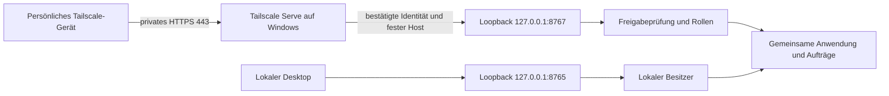

# Privater Familienzugang

Unter **Familienzugang** legt der Besitzer persönliche Freigaben an: den tatsächlichen Tailscale-Anmeldenamen, Anzeigenamen, Rolle und erlaubte Server auswählen. Eine Freigabe versendet keine Einladung. Die Person braucht zusätzlich Tailscale auf ihrem Gerät und eine gezielte Gerätefreigabe bzw. Netzwerkberechtigung. Persönliche Konten verwenden; ein gemeinsam verwendetes Tailscale-Konto würde alle Geräte als dieselbe Person ausweisen.

Familienbediener dürfen ihre freigegebenen Server sehen und starten. Stoppen, Neustarten, Einrichten, Konfiguration, Logs, Discord und Besitzerexporte bleiben gesperrt. Für Stoppen/Neustart fehlt noch die verlässliche Belegungsprüfung aus #14; unbekannte Belegung bedeutet keine Unterbrechung. Leser dürfen ausschließlich lesen. Ein ausdrücklich angelegter Besitzerzugang besitzt vollen Verwaltungszugriff einschließlich Freigaben. Gemeinschaftsbeiträge für Familienprofile und Steam-Kontozuordnung folgen getrennt in #37/#23.

Eine Person bearbeiten und **Zugang freigegeben** abwählen sperrt neue Anfragen sofort, auch in bereits geöffneten Browsern. Änderungen an Rolle/Servern entwerten alte CSRF-Token. Nach Neuladen gelten die neuen Rechte. Wartende Spielaufträge prüfen die unveränderte Freigaberevision vor ihrem Beginn erneut. Bereits begonnene Betriebssystemaktionen werden durch Sperren eines Benutzers nicht rückgängig gemacht. Bestehende Freigaben ändern ihren Anmeldenamen nicht: Für eine andere Identität einen neuen Zugang anlegen und den alten sperren.

## Vertrauensgrenze

Beide Listener teilen genau eine Anwendung und Auftragsverwaltung. Der bisherige lokale Zugang ignoriert eingehende Identitäts-/Rollenheader weiterhin. Er akzeptiert ausschließlich seine localhost-Hosts. Der zweite Listener verwendet niemals einen lokalen Besitzer-Fallback: fester konfigurierter Tailscale-Hostname, bestätigter `Tailscale-User-Login` und aktive persönliche Freigabe sind erforderlich. Fremde Rollen-, Forwarded- und Profilbildheader vergeben keine Rechte. Pro Anfrage wird die Freigabe frisch gelesen. Endpunkt deaktivieren oder dessen Host ändern sperrt den bestehenden Familienlistener sofort; für den neuen Host/Port den Manager neu starten. Ein fehlerhafter Familienlistener verhindert nicht den lokalen Besitzerzugang.

Tailscale Serve entfernt eingehende Tailscale-Identitätsheader und setzt die bestätigte Gerätebenutzer-Identität selbst. Identitätsheader fehlen bei getaggten Geräten und bei öffentlichem Funnel; diese erhalten hier keinen Zugriff. TCP/8767 und TCP/8765 sind keine Netzwerkfreigaben. Ausschließlich ein lokaler Serve-Prozess darf die Header über den zweiten Loopback-Listener liefern. Betriebssystemzugriff auf den Besitzerrechner gehört zur Vertrauensgrenze: Lokale Prozesse dieses Kontos haben ohnehin den bisherigen Besitzerzugang. Das ist keine Mehrbenutzer-Sicherheitsgrenze gegen beliebige lokale Schadsoftware.

Der Familienlistener erwartet dieselbe feste HTTPS-Origin wie sein Host, auch wenn der letzte Transportweg vom lokalen Proxy HTTP ist. Der lokale Listener behält seine HTTP-Origin. Doppelte Host-/Origin-/Token-/Identitätsheader werden abgelehnt. Die CSRF-Token sind an Listener, persönliche ID und Freigaberevision gebunden; ein Token einer anderen Person oder vom lokalen Besitzerlistener erteilt keinen Zugriff. Es gibt keine globale CORS-Freigabe und keine aus dem Browser übernommene Rolle. Tailscale übernimmt die persönliche Anmeldung bei jeder Anfrage; ein CSRF-Token ist weiterhin keine Anmeldung.

## Windows und WSL einrichten

1. Tailscale auf Windows installieren und mit dem eigenen Konto anmelden. Der Host bleibt Windows, damit Dienst und private Verbindung nicht von einer bereits laufenden WSL-Sitzung abhängen.
2. In nativer Windows PowerShell als Administrator `scripts/configure-family-network.ps1 -Mode Configure` ausführen. Es aktiviert unbeaufsichtigtes Tailscale, lässt fremde Routen und DNS-Übernahme auf dem Spielhost aus und richtet privaten Serve für `http://127.0.0.1:8767` ein. Die einmalige HTTPS-Freigabe auf der offiziellen Tailscale-Seite selbst abschließen. Es wird kein Funnel eingerichtet. Bestehende andere TCP-/Web-/temporäre Serve-Dienste oder Funnel werden vor Änderungen abgelehnt, statt überschrieben. Nur die exakt eigene HTTPS/443-Konfiguration darf wiederholt eingerichtet werden. Adapterregeln können andere bereits im Tailscale-Netstack verarbeitete Serve-Ports nicht absichern; daher die vorherige Gesamtkontrolle.
3. Das Skript beschränkt eingehende Verbindungen auf dem ausdrücklich benannten **Tailscale**-Adapter: TCP außer 443 und UDP werden gesperrt. Der Windows-Firewalldienst und alle Firewallprofile müssen aktiv sein. Bereits vorhandene Regeln werden anhand Aktivierung, Richtung, Aktion, Gruppe, Profil, Adapter, Protokoll, Ports und zusätzlicher Adress-/Programm-/Dienst-/Sicherheitsfilter geprüft; bei Abweichungen keine Serve-Freigabe. Physische Adapter, normale LAN-Verbindungen und öffentliche Spielports sind nicht betroffen. Die Regeln gehören nur zum Familienzugang und werden beim Deaktivieren des Dashboard-Endpunkts nicht entfernt. Zusätzlich im Tailnet nur gezielte Geräte-/HTTPS-Freigaben für Familienpersonen vergeben; keine Subnet-Routen oder Exit-Nodes freigeben. Regeln/Serve von einem zweiten Gerät prüfen, bevor andere Personen Zugriff erhalten.
4. Den vollständigen Tailscale-Gerätenamen, etwa `rechner.tailnet.ts.net`, und den lokalen Familienport im Dashboard hinterlegen und aktivieren. Nur die Verwaltung neu starten. Mindestens den persönlichen Besitzerzugang bewusst freigeben; fremde Konten bleiben gesperrt. Den Link `https://<Gerätename>` vom anderen Tailscale-Gerät öffnen. Das Spielserverpasswort ist kein Dashboard-Kennwort.
5. Für die Familie persönliche Gerätefreigaben/Netzrechte und passende Dashboard-Freigaben einrichten. Keine Einladung wird automatisch versendet. Die Netzwerkfreigabe allein vergibt keine Dashboard-Rolle.

`configure-family-network.ps1` ohne Parameter gibt einen begrenzten Einrichtungsstatus aus. Keine API-Schlüssel sind für die persönliche Serve-Identität erforderlich. Der Spielhost selbst übernimmt dabei kein MagicDNS; für einen Selbsttest gegebenenfalls eine gezielte Namensauflösung verwenden. Andere Clients verwenden Tailscale-DNS für den privaten Gerätenamen.

## Start ohne Windows-Anmeldung

Tailscale allein startet den WSL-Manager nicht. `scripts/install-family-startup.ps1 -PlanOnly` zeigt die konkret geplante Aufgabe. Der normale Aufruf fragt im Windows-Anmeldedialog nach dem **Windows-Kontokennwort des bestehenden Besitzerkontos**, nicht nach dem Windows-Hello-PIN. Der Wert gehört nicht in Chat, Projektdateien oder Kommandozeilen. Die Windows-Aufgabenplanung speichert ihre eigene Anmeldeinformation; der Manager speichert kein Kennwort.

Die Aufgabe startet bei Windows-Start ausschließlich den vorhandenen Desktop-Starter mit `-NoBrowser` im gleichen Konto wie die WSL-Distribution und ASKA-DPAPI. Keine Spielserver werden automatisch gestartet. S4U wird bewusst nicht verwendet: Dieser Anmeldetyp hat keinen Zugriff auf verschlüsselte Benutzerdateien und eignet sich deshalb nicht als zugesicherter Kontext für die bestehende ASKA-Anbindung. Ein geplantes Betriebsfenster muss Start nach Neustart ohne Desktop-Anmeldung, WSL-Weiterleitung und ASKA-DPAPI bestätigen. Ohne diesen Praxistest ist Dauerbetrieb nicht abgenommen. Während einer laufenden Spielrunde nicht neu starten/abmelden; #16 hält den umfassenden Dauerbetrieb fest.

## Daten und Protokoll

`data/access-settings.json` enthält Aktivierung, Host und Port. `data/access.sqlite3` (eigenes Schema 1) enthält persönliche Freigaben und ein begrenztes Zugriffsprotokoll; Dateirechte 0600. Sie sind bewusst getrennt von `platform.sqlite3`: Ein Wiederherstellen alter Chronikdaten darf gesperrte Zugänge nicht versehentlich reaktivieren. Die Chronik-Sicherung/-ZIP enthält daher keine Benutzerfreigaben. Diese beiden Zugangsdateien bei einer vollständigen Verwaltungssicherung separat und geschützt sichern; nach Rückspielen die aktuellen Freigaben prüfen. Keine Steam-Passwörter, Tailscale-Anmeldetoken oder Windows-Kennwörter liegen dort.

Protokolliert werden bestätigte Sitzungsabrufe, schreibende Anfragen/Ergebnisse, Freigabeänderungen und API-Zugriffsfehler mit Akteur und Zeitpunkt. Erfolgreiche laufende Statuspolls werden nicht einzeln gespeichert. Höchstens 10000 Protokollzeilen bleiben erhalten, die Oberfläche zeigt die letzten 100. Anfragen enthalten weder Body, Passwort, Token, Webhook noch Querystring im Protokoll. Spielaufträge halten zusätzlich den Akteur und das tatsächliche spätere Ergebnis fest. Nicht bestätigte Anfragen erscheinen ohne übermittelten Anmeldenamen als unbekannter Zugang.

API: `GET /api/access`, `POST /api/access/settings` und `POST /api/access/users` benötigen `access.manage` (Besitzer). Benutzeränderungen verwenden ID und erwartete Revision; konkurrierende oder veraltete Freigaben überschreiben sich nicht stillschweigend.

## Abnahme

Automatisch geprüft werden Rollen und Profilgrenzen, direkte Nebenwege/fremde Header, private Origin/CSRF, verschiedene Benutzer, Entzug bestehender Token, wartende Aufträge, Protokoll ohne Geheimnisse, konkurrierende Freigaben, Browserentwürfe und mobile Viewports. Die Browserfixture verwendet einen ausschließlich dort vorhandenen Serve-Stellvertreter; er ist kein Produktionsadapter. Windows-Einrichtungstests ersetzen **sämtliche** Modulimporte/Netz-/Aufgabenbefehle durch isolierte Testfunktionen.

Zusätzlich real prüfen: zweites persönliches Gerät über Mobilfunk, nur HTTPS erreichbar (keine SMB/RDP-/Shell-/Managerports), berechtigter Start eines freien Servers, verweigerte direkte API-Aufrufe, Zugang sperren und Start nach Windows-Neustart ohne Anmeldung. Ein Eigentest mit dem Besitzergerät bestätigt keine andere Familienidentität oder externe Erreichbarkeit.

Quellen: [Serve und Identitätsheader](https://tailscale.com/docs/features/tailscale-serve#identity-headers), [unbeaufsichtigter Windows-Betrieb](https://tailscale.com/docs/how-to/run-unattended), [Serve-Persistenz](https://tailscale.com/docs/reference/tailscale-cli/serve), [Windows-Aufgaben-Anmeldetypen](https://learn.microsoft.com/en-us/windows/win32/api/taskschd/ne-taskschd-task_logon_type).
