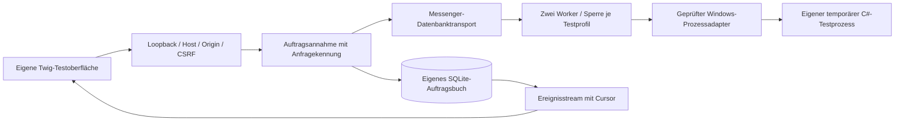

# Symfony-Migration

Am 16.10.2026 hat der Nutzer die Migration freigegeben und anschließend die autonome Weiterarbeit bis zur Umsetzung des Epics beauftragt. Symfony ist ihm vertraut; Lesbarkeit und eigener Review des Anwendungskerns sind Auswahlkriterien. [Epic #45](https://github.com/korvegan/gameserver-indy/issues/45) koordiniert die Schritte. Der erste Durchstich #46 ist abgeschlossen und läuft getrennt von der bestehenden Python-Verwaltung. Das bisherige Architekturpapier dokumentiert deren weiterhin produktiven Stand.

## Teilissues und Abgrenzung

| Issue | Umfang | Grundlage |
| --- | --- | --- |
| [#46](https://github.com/korvegan/gameserver-indy/issues/46) | Isolierter Browser-/Auftrags-/Windows-Durchstich | abgeschlossen mit #55 |
| [#47](https://github.com/korvegan/gameserver-indy/issues/47) | Persönliche Identität, Tailscale, Freigaben, stabile Sitzungen | #46; bestehendes #17 |
| [#48](https://github.com/korvegan/gameserver-indy/issues/48) | Spielkatalog, Profile und exakte Konfigurationsadapter | #46/#47; bestehendes #5 |
| [#49](https://github.com/korvegan/gameserver-indy/issues/49) | Produktive Aufträge und Windows-Steuerung | #46–#48; Betriebsgrenzen #7/#8/#14 |
| [#50](https://github.com/korvegan/gameserver-indy/issues/50) | Bestehende Weltsicherungen und Restore | #48/#49; umgesetztes #6 |
| [#51](https://github.com/korvegan/gameserver-indy/issues/51) | Chronikdaten, Medien und feste Szenenreferenzen | #46/#47; bestehendes #24/#25 |
| [#52](https://github.com/korvegan/gameserver-indy/issues/52) | Vorhandenes Dashboard mit Twig/UX und gezielten Vue-/TypeScript-Komponenten | Fachmodule und #51 |
| [#53](https://github.com/korvegan/gameserver-indy/issues/53) | Bestehende Steam-/Discord-Verträge und Providergrenzen | #47–#49/#51 |
| [#60](https://github.com/korvegan/gameserver-indy/issues/60) | Persönliche WhatsApp-Verknüpfung, Bereitschaft und dauerhafte Versandclaims | neuer Bestand aus #58/#59; #47–#49/#53/#52 |
| [#54](https://github.com/korvegan/gameserver-indy/issues/54) | Nativer Betrieb, Release, geplante Umschaltung und Rückweg | abgenommene Fachmigration einschließlich #60 |

Neue Funktionen aus den vorhandenen Issues bleiben dort beauftragt und abgenommen. Die Migration installiert keine Mods, erkennt keine neuen Errungenschaften und erklärt fehlende Bereitschafts-/Belegungsquellen nicht als vorhanden. Ein C#-Agent und AMP sind nicht Teil des ersten Durchstichs. Die Produktionsumschaltung gehört ausdrücklich zu #54.

## Neue Bestandsaufnahme am 16.10.2026

Referenz ist `main` mit Commit `dfbe7c29de08a6a44088e996bc95b3c711cd8d37` nach PR #59. Geprüft wurden Repository, abgeschlossene PRs, offene Issues und lesend die produktiven Datenbankversionen, Listener und der WhatsApp-Status. Private Inhalte wurden dafür nicht exportiert. Diese Aufnahme ersetzt den Umfang des ersten Durchstichs als Migrationsbaseline; spätere fachliche Änderungen müssen gegen dieselbe Matrix abgeglichen werden.

### Änderungen seit dem ersten Symfony-Durchstich

| Änderung | Neuer zu erhaltender Vertrag | Zuordnung |
| --- | --- | --- |
| [PR #56](https://github.com/korvegan/gameserver-indy/pull/56) | Chronik-Editor erst mit bestätigter Schreibberechtigung und geladenem Katalog bedienbar; verzögerte Startantworten dürfen keinen Klick verschlucken. | #47, #51, #52 |
| [PR #57](https://github.com/korvegan/gameserver-indy/pull/57) | `servers[].connection.public_host`, feste öffentliche Adresse auch ohne frischen IP-Cache, gemeinsamer Beitrittstext in Übersicht und Discord; Entwürfe und Profilwechsel absichern. | #48, #52, #53 |
| [PR #59](https://github.com/korvegan/gameserver-indy/pull/59), [Issue #58](https://github.com/korvegan/gameserver-indy/issues/58) | Verbundenes persönliches WhatsApp-Konto, gewählte Gruppe, Automatik je Profil, aktuelle Startbereitschaft und dauerhafter Versandstand. | eigenes neues #60; Schnittstellen zu #47/#49/#52/#53/#54 |

Die frei bedienbaren Start-/Stopp-/Neustartaufträge und stabilen Browsersitzungen aus PR #44 sowie die 72h-Weltsicherung aus PR #43 bestanden schon vor #55. Sie gehören weiterhin zum vollständigen Bestand und sind durch den isolierten Symfony-Durchstich noch nicht vollständig für echte Profile übertragen.

### Funktionsmatrix

| Bereich | Produktiver Bestand in Python | Symfony-Stand und nächster Nachweis |
| --- | --- | --- |
| Rechte und Familienzugriff | Lokaler Besitzer, eigener privater Serve-Listener, persönliche revisionierte Freigaben und Audit. Die beiden eingerichteten Familienpersonen haben auf Nutzerwunsch Besitzerrechte. Persönliche WhatsApp-Kontoverwaltung bleibt trotzdem lokal. | #47 / PR #62: persönliche Identität, Profilgrenzen, Entzug in Queue/Live-Abos und kompatible Schlüssel implementiert und isoliert geprüft. Tatsächliche Bestandskopie und externer Symfony-Zugang folgen #54. |
| Spiele und Konfiguration | Enshrouded/ASKA, zusätzliche Katalogeinträge, getrennte Instanzen; Enshrouded-1.0-Felder und unbekannte Felder; externe ASKA-Textdatei/Save-ID/Starter. | #48 / PR #63: Katalog/Instanzen, registrierte Adapter, Metadatenimport, bytegenaue Sicherung, Weltgrenzen und öffentliche Profiladresse implementiert. Sprachvergleich mit Python bestanden; echte Bestandsübernahme folgt #54. |
| Aufträge und Prozesse | FIFO der drei Serverbefehle, parallele getrennte Ziele, exklusive Änderungen/Backups, Wiederanlauf ohne Replay, kanonische native Windows-Pfade und externer Starter. | #49 / PR #64: registrierte native Profiladapter, geteilter Beobachter, exklusive Config-/Setupjobs, frische Rechte-/Laufprüfungen und Wiederanlauf ohne Replay implementiert. Native Prüfung mit eigenen Stellvertretern; endgültiger Supervisor und Produktionsabnahme folgen #54. |
| Bereitschaft und Logs | Bereinigte Logquellen. Seit #59 eine eng begrenzte aktuelle Bereitschaftsprüfung für WhatsApp; Prozess, Sitzungsbereitschaft und externer Beitritt bleiben verschieden. | #49/#60 übertragen vorhandene Quellen und Bereinigung. Die vollständige Zustandsverwaltung #7 und Shader-/Logausbauten #11/#12 sind weiterhin offen. |
| Weltsicherungen | Vollständige Offline-Kopie, Manifest/Hashes, Anheften, 72h rollend nach neuem Erfolg, Rückwegsicherung und persistente Restore-Sperre. | #50: eigener PHP-Archiv-/Dateidienst, Offline-Transaktionen und Queue-Anbindung implementiert. Isolierte vollständige Rückwege, ASKA-Köderwelt und Python-Archivvergleich geprüft; Originalbestände und integrierte Oberfläche folgen #52/#54. |
| Sturmklingen | Manuelle Gruppenmomente, gemeinsame Auszeichnungen, Medien/Vorschauen, Korrekturen, Archivexport und feste Wandteppichkapitel/-plätze. | #51: PHP-Fachdienste, kompatibles Schema 2, geprüfte Kopiermigration, Medien und Export implementiert. IDs/Revisionen/Plätze und Sprach-Rückweg isoliert geprüft; Oberfläche #52 und Originalbestandsabnahme #54 folgen. |
| Steam und Beitritt | Lesender Manifest-/SteamCMD-Vergleich, Branch/Cache/Takt/Unbekannt; native Windows-Netzadressen und gespeicherte öffentliche Domain. | #53: noch nicht migriert. Keine Aktualisierung oder externe Netzabfrage je Statuspoll ergänzen; Formatter aus #57 übertragen. |
| Discord | Webhook, Start/Stopp/Neustart, Beitrittsinfos und manueller Entwurf; externer ASKA-Starter besitzt seine Startmeldung. Chronik besitzt bereits dauerhafte Versandzuordnungen. | #53: bestehende Verträge übernehmen. Neue Statuskarten und tatsächliche Chronik-Veröffentlichung bleiben #15/#26. |
| WhatsApp | WAHA/GOWS auf Loopback, verknüpftes Konto, ausgewählte Gruppe, kurze Meldungen, revisionsgebundene Freigabe, private Claims ohne blindes Replay. | #60: noch nicht migriert. Konto/Container und bereits bestätigten Enshrouded-Versand erhalten; keine neue Testmeldung oder QR-Verknüpfung allein wegen der Migration. |
| Oberfläche | Übersicht, Einstellungen, Logs, Sicherungen, Discord, WhatsApp, Profile, Spiele/Mods, Sturmklingen und Familienzugang; Profilwahl und Entwürfe bleiben stabil. | #52: bisher eigene kleine Twig-Testseite mit Aufträgen und SSE. Vorhandene Gestaltung und Browserverträge übertragen; Komponenten nach tatsächlichem Bedarf wählen. |
| Betrieb | Windows-/WSL-Launcher, Desktop-Verknüpfung und Aufgabe im Besitzerkonto; privates Tailscale Serve; eigener WhatsApp-Container. | #54: noch kein produktiver Symfony-Start. Nur eine Verwaltung einschließlich Benachrichtigungsplaner aktiv; Datenkopie, Rückweg, Ressourcenvergleich und Betriebsabnahme erforderlich. |

### Daten und Dienste beim Wechsel

| Bestand | Übernahme und Rückweg |
| --- | --- |
| `manager.local.json` | Profile, externe Konfigurations-/Starterpfade, gemeinsame Einstellungen und `connection.public_host` explizit übernehmen. Unbekannte Felder erhalten. |
| Spielkonfigurationen und externe ASKA-Dateien | Originalstand bytegenau sichern und vergleichen. Save-ID, Bestandswelt und Besitzer-/DPAPI-Kontext nicht aus einem Demo-Profil ableiten. |
| `data/platform.sqlite3`, Schema 2 | Jobs, Ereignisrevisionen, Medien, feste Szenen und Ereignis-Versandzuordnungen übernehmen. Wartende/unklare Jobs nicht nachträglich ausführen. |
| `data/access.sqlite3`, Schema 1; `access-settings.json`; `session-key` | Freigaben, IDs, Revisionen, Audit, Listenergrenzen und bestehenden Signaturschlüssel getrennt von Chronik/Welt-Restore erhalten. Alte gültige Sitzungen bleiben nutzbar, entzogene Freigaben bleiben ungültig. |
| `data/world-backups/` und Wiederherstellungsmarkierungen | Archive, Index/Prüfsummen, Pins, Aufbewahrungsregeln und Pending-Sperren erhalten. Keine „Bereinigung“ als Importnebenwirkung. |
| `data/whatsapp/settings.json`, `deliveries.sqlite3` | Tatsächliche Gruppen-ID, Profile, Revision und `sent`/unklare Claims kopieren und vergleichen. Die Claim-Datenbank besitzt derzeit keine `user_version`-Kennung; Struktur und erlaubte Zustände explizit prüfen, nicht als leere Datenbank behandeln. |
| `data/whatsapp/credentials.json`, Sitzungsverzeichnis und Compose-Dienst | Private Kontoverknüpfung außerhalb des App-Releases erhalten. Keine Kontodaten in allgemeine Exporte oder öffentliche Migrationsberichte aufnehmen. Nur ein Benachrichtigungsplaner darf arbeiten. |
| Steam-Cache und technische Verlaufs-/Launcherdateien | Geheimnisbereinigung und fachliche Bedeutung erhalten; ein Cache ist kein Nachweis eines aktuellen oder laufenden Builds. |
| Desktop-/Boot-Starter und Tailscale Serve | Beim Cutover denselben Benutzerkontext, öffentliche private URL und Listenervertrag erhalten. Externer dedyn-Timer und vorhandener Gateway gehören zu anderer Infrastruktur und werden durch die Appmigration nicht umgestellt. |

Die lesende Betriebsaufnahme bestätigte: Python bedient weiterhin Port 8765/8767; Enshrouded läuft, ASKA ist gestoppt. WhatsApp ist verbunden, für beide Profile aktiviert und besitzt genau einen bestätigten Claim des vereinbarten Enshrouded-Testversands. Das sind zeitgebundene Befunde, keine Zusicherung für einen späteren Cutoverzeitpunkt.

### Reihenfolge und Abschlussgrenze

1. #47 Identität/Freigaben/Sitzungen, anschließend #48 Profile/Konfiguration und #49 produktive Aufträge/Prozessgrenze.
2. #50 Sicherungen und #51 Chronik auf Kopien mit vollständigem Rückweg. Bestehende Daten- und Berechtigungsgrenzen entscheiden über die Abnahme.
3. #53 Steam/Beitritt/Discord und eigenes #60 WhatsApp mit demselben Beitrittsvertrag. Die Oberfläche #52 schließt alle übernommenen Bereiche einschließlich WhatsApp ein. Fachmodule erhalten ihre eigenen PRs; Rückmeldungen und Browserverträge werden beim jeweiligen Modul geprüft.
4. #54 führt geprüfte Bausteine zusammen: konsistente Verwaltungssicherung, genau eine schreibende Verwaltung und genau ein Benachrichtigungsplaner, unveränderte Welten, kontrollierter Rückweg, Launcher und Familienzugriff.

Für den aktuellen Python-Referenzstand sind 158 Backendtests im normalen Lauf erfolgreich (fünf optionale native Prüfungen dabei ausgelassen), 19 JS-Module und acht Browserabläufe geprüft; die sechs CI-Prüfungen von PR #59 und `main` sind grün und enthalten zusätzliche native Windows-Tests. Der Symfony-Durchstich hatte 20 PHP-Tests einschließlich nativer Windows-Abnahme sowie echte SSE-/Browserprüfungen. Diese Zahlen sind der Ausgangspunkt; entscheidend ist dieselbe beobachtbare Bedienung im Zielsystem.

Die allgemeine Backlog-Bewertung vom 15.10. ist eine historische Priorisierung. Weiterhin offen sind insbesondere automatische Updates #9, Ressourcenverläufe #8, Spielerbelegung #14, Mehrserverkarten #10, Modinstallation/-quellen/-verteilung #19–#21, automatische Errungenschaften/Steam-Identitäten #23/#37 sowie Discord-Erfolgskarten #26. Die Migration setzt diese Funktionen nicht nebenbei um. #6/#24/#29/#58 sind implementierter Bestand; #17/#25 besitzen umgesetzte Teile und verbleibende Betriebs-/Geräteabnahmen.

Ein Windows-Kaltstart ohne Desktop-Anmeldung, echter ASKA-Speicherabschluss und der externe Familienzugriff auf das neue Symfony-System bleiben konkrete Betriebsnachweise. Sie werden nicht aus Testprozessen, dem bisherigen Python-Betrieb oder grüner CI abgeleitet. Ein Neustart während einer laufenden Spielrunde ist weiterhin kein Einrichtungstest.

## Durchstich #46

Unter `symfony/` liegen ein eigenständiges Symfony-7.4-LTS-Projekt, Composer-Lockfile, Twig-Oberfläche, SQLite-Auftragsbuch, Messenger-Datenbanktransport und eine begrenzte SSE-Anzeige. Alle Symfony-Hauptkomponenten sind auf 7.4 begrenzt; die Sperrdatei hält die geprüften Versionen fest. PHP 8.5 wird lokal und in CI geprüft, das Projekt verlangt mindestens PHP 8.4.



Es gibt ausschließlich `demo-a` und `demo-b`, mit festem Programmnamen `indy-symfony-standin.exe`. Der Simulator verwendet eigene kleine Statusdateien. Der Windows-Modus erzeugt seine eigenen Programme aus `tests/Fixtures/Standin.cs`; er nutzt den bestehenden `scripts/windows-server.ps1` ohne Änderungen. Ein ausschließlich für diese Testprofile vorgesehener Wrapper hält dessen Rückmeldung in einer kurzlebigen Antwortdatei mit zufälliger Kennung fest, weil der Konsolenwechsel beim nativen PHP-Stopp dessen Standardausgabe ungültig machen kann. Vollständiger EXE-Pfad und PID entscheiden über die Zuordnung. Ein `ready.pid` und eine vom Testprozess geschriebene `graceful-stop.txt` belegen Bereitschaft bzw. reguläres Ctrl+C ausschließlich dieses Testprogramms.

### Starten

Benötigt werden PHP 8.5 mit PDO SQLite/üblichen Composer-Erweiterungen, Composer 2, Python 3 und FrankenPHP. Node/Playwright sind nur für die Browserprüfung erforderlich. Keine zusätzlichen Datenbank-/Redis-/Containerdienste sind nötig.

```bash
composer install --working-dir=symfony
python3 symfony/tools/run_slice.py
# Optional, ausschließlich in Windows oder WSL mit Windows-PowerShell:
python3 symfony/tools/run_slice.py --driver windows
```

Aufruf: `http://127.0.0.1:18865`. Der Starter akzeptiert nur isolierte Ports 18800–18999; er verändert weder Desktop-Verknüpfung noch Tailscale oder Autostart. `--php`, `--frankenphp` bzw. `SLICE_PHP`/`SLICE_FRANKENPHP` wählen vorhandene Werkzeuge. `--state-dir` wählt einen eigenen Datenordner, standardmäßig `symfony/var/slice`. Ein fehlender Marker wird nur in einem leeren Ordner angelegt. Der Starter bindet ausschließlich Loopback; Caddy-Admin ist deaktiviert, Caddy-Konfigurations-/Speicherdaten liegen ebenfalls im Testdatenordner. Beenden mit Ctrl+C stoppt die gestarteten Web-/Workerprozesse und im Windows-Modus ausschließlich die eigenen Standins.

### Ausführungsvertrag

- `POST /api/jobs` nimmt nur `{server_id, operation, request_id}` an und antwortet mit HTTP 202 und stabiler Auftrags-ID. Dieselbe Anfragekennung mit gleichem Ziel/Befehl gibt denselben Auftrag zurück; eine andere Bedeutung derselben Kennung ist ein Konflikt.
- Auftragsbuch und Messenger-Zustellung werden über dieselbe DBAL-Verbindung atomar gespeichert. Höchstens 16 offene Aufträge insgesamt und acht pro Testprofil. Annahme sperrt nur die kurze Datenbanktransaktion; lange Windows-Aufrufe laufen im Worker.
- Die Worker-Sperre gilt je Profil. Auch eine anders sortierte Messenger-Zustellung führt die offenen Aufträge nach ihrer Datenbanksequenz aus. Ein freier anderer Testserver kann parallel bearbeitet werden.
- Der Seiteneffekt beginnt erst nach dauerhaftem `running`. Eine freie Workersperre bei weiterhin `running` belegt einen verlorenen Worker; betroffener Auftrag und wartende Folgebefehle werden `interrupted`. Ein Abgleich beim Lesen der Aufträge und etwa jede Sekunde im SSE benötigt dafür keine erneute Messenger-Zustellung. Fehler/unklare native Antworten unterbrechen wartende Folgebefehle. Ein Speicherfehler erhält die Zustellung bis zum sicheren Abgleich; nach einem dauerhaften Claim darf eine Wiederzustellung ausschließlich unterbrechen, keinen Seiteneffekt wiederholen. Vor dem Claim darf die Zustellung auf die Workersperre bzw. die Rückkehr des Speichers warten.
- Der SSE-Cursor und die erste Auftragsliste stammen aus demselben SQLite-Snapshot. Annahmeantwort, Snapshot und Ereignisse werden über die pro Auftrag aufsteigende Revision zusammengeführt; verspätete Antworten dürfen keinen neueren Status ersetzen. Verbindungen laufen begrenzt zehn Sekunden und setzen anschließend über `Last-Event-ID` fort. Historische Abschlussereignisse werden beim Neuladen nicht als neue Starts wiedergegeben.
- `data` der Produktionsverwaltung, `manager.local.json`, Spielkonfigurationen, Webhooks und echte Welten werden nie importiert. Die Testschlüsseldatei bleibt privat im eigenen Ordner und erhält den CSRF-Vertrag über Prozessneustarts. Abgewiesene POSTs werden nicht automatisch wiederholt.

### Rechte und noch offene Abnahmen

Dies ist ein lokaler Durchstich, keine neue Familienanmeldung. `SLICE_ROLE=viewer` ist ein nur beim Start festgelegter isolierter Lesermodus für Tests, keine Rolle aus einem Browserheader. Produktiver Identitätsadapter und Freigaberevisionen folgen #47. Die Oberfläche nennt ihren Testbetrieb ausdrücklich.

PHP-/Windows-Dienststart ohne Desktop-Anmeldung, ASKA-DPAPI, echte Welt-Speicherabschlüsse und produktive Profil-/Datenmigration sind hier nicht bestätigt. Auch ein neuer nativer Windows-FrankenPHP-Host wurde mit diesem WSL-Durchstich nicht abgenommen. Datenaufbewahrung, Produktionsbeendigung und Supervisor/Release-Lebenszyklen werden vor dem Cutover in #49/#54 vervollständigt. Ein Durchstich ersetzt diese späteren Abnahmen nicht.

## Persönlicher Zugriff #47

`src/Access/` ergänzt Symfony Security mit einem eigenen zustandslosen Authenticator und einem Permission-Voter. `Principal` trägt Rolle, erlaubte Profile und Freigaberevision; Browserheader vergeben keine Rollen. `AccessStore` verwendet das bestehende separate Schema 1 für Freigaben und Audit. Die beiden eingerichteten Familien-Besitzerrollen bleiben Besitzerrollen; die persönliche WhatsApp-Kontogrenze aus #60 richtet sich zusätzlich nach dem lokalen, uneingeschränkten Besitzer und nicht allein nach der Rolle.

Der lokale und der private Listener sind getrennt. Im realen FrankenPHP-Test wurde beobachtet, dass `SERVER_PORT` aus dem öffentlichen Hostnamen stammt (ohne Port z. B. 80), nicht zuverlässig aus dem tatsächlichen Backend-Listener. Jeder `php_server`-Block setzt deshalb **`INDY_LISTENER_PORT` als geschützte CGI-Variable** fest aus seiner eigenen Konfiguration. Ein HTTP-Header gleichen Namens erzeugt nur `HTTP_INDY_LISTENER_PORT` und ersetzt diese Variable nicht. Direkter Peer, erwarteter Listener, exakter Host, persönliche Serve-Identität, HTTPS-Origin und CSRF-Scope werden gemeinsam geprüft. `Forwarded`- und Rollenheader bleiben unmaßgeblich. Ein leerer/unbekannter Listenerkontext wird abgewiesen.

`session-key` übernimmt den bisherigen 43-stelligen privaten Schlüssel und denselben zweistufigen HMAC-Vertrag für privaten Listener und Freigaberevision. Feste synthetische Testvektoren aus dem Python-Vertrag prüfen die Kompatibilität. Der isolierte Vorläuferschlüssel `csrf-key` wird nicht mehr verwendet. Ein beschädigter Schlüssel wird nicht automatisch ersetzt. Der Appcache kann mit `INDY_CACHE_DIR` getrennt gehalten werden; der Teststarter verwendet je Datenordner einen eigenen benachbarten Cache mit zusätzlicher Betriebssystemtrennung. Damit verwendet eine neue Fixture keine alten kompilierten Konstruktoren eines vorherigen Entwicklungsstands.

Angenommene Aufträge speichern eine begrenzte Akteurszuordnung mit ID, Rolle, Profilgrenzen und Revision, ohne Login oder Sitzungsschlüssel. Der Worker prüft die Freigabe erneut vor der Spielaktion. Benutzerentzug, Rollen-/Profiländerung und ein deaktivierter Familienzugang unterbrechen wartende private Aufträge ohne Ausführung. Ein bestehender Live-Stream prüft Identität/Freigabe weiter und schließt beim Entzug. Verschwindet die Freigabe zwischen zwei begrenzten Streams, erkennt die Oberfläche den bestätigten Entzug durch eine lesende Sitzungsabfrage; ein bloßer Netzwerkfehler sperrt die Befehle nicht. POSTs werden dabei weiterhin nicht automatisch wiederholt.

Die privaten API-Routen `/api/access`, `/api/access/users` und `/api/access/settings` verwenden dieselben Besitzerrechte wie der Bestand. Benutzerfreigaben werden mit Compare-and-swap-Revisionen gespeichert. Die Produktionsoberfläche folgt #52; dieser Schritt ergänzt die eigene Twig-Testseite um reale serverseitige Freigaben, Rollen und Profilgrenzen. `run_slice.py --port 18866 --family-port 18868` startet dafür zwei eigene Loopbacklistener, niemals die produktiven Ports oder echtes Tailscale Serve.

```bash
php bin/console indy:access:snapshot /privat/alte-data-kopie /privat/neues-zugangspaket
```

Der Konsolenbefehl liest den Bestand ausschließlich lesend und erzeugt ein neues privates Paket mit konsistentem SQLite-Snapshot, unveränderten Freigabe-IDs/Revisionen/Audit, Einstellungen, Signaturschlüssel und Hashmanifest. Vorhandene Ziele sowie unbekannte Versionen/Strukturen werden abgewiesen. Das Paket aktiviert keinen Zugang und überschreibt keine laufende Verwaltung. Chronik und Welten werden nicht einbezogen. Die kontrollierte Aktivierung und ein Rückweg mit späteren Änderungen gehören zu #54.

HTTP-Tests decken gefälschte Header, Profil-/Rollengrenzen, HMAC-Kompatibilität, veraltete Revisionen, wartende Aufträge und das private Kopierpaket ab. Der Browserlauf verwendet ausschließlich synthetische Freigaben und einen lokalen Serve-Stub vor dem echten FrankenPHP-Backend. Er prüft auch Live-Entzug zwischen Verbindungen und den tatsächlichen App-/Workerneustart mit privatem Token. Dieser Stub ersetzt keine externe HTTPS-/Familienabnahme. Die Prozessprüfung verwendet weiterhin ausschließlich eigene Windows-Stellvertreter; Produktionsprofile, echte Familienfreigaben und Spielwelten werden durch diese Tests nicht umgestellt.

## Spielprofile und Konfiguration #48

`src/Game/` enthält je einen eigenen Enshrouded-/ASKA-Konfigurationsadapter. Symfony sammelt Implementierungen von `ConfigurationAdapter` über einen [Service-Tag](https://symfony.com/doc/7.4/service_container/tags.html); `GameCatalog` verbindet sie mit den bisherigen JSON-Spielprofilen unter `profiles/`. Für ein weiteres Spiel einen Adapter mit eigener ID und das zugehörige geprüfte Formularschema ergänzen, anschließend Vergleichsfixtures und Prozess-/Weltfähigkeiten getrennt hinzufügen. Ein zusätzlicher reiner `catalog_games`-Eintrag erzeugt keinen Dedicated-Server- oder Modadapter. Kampagne, Instanz und künftige Modquelle bleiben getrennte Identitäten.

`InstanceRegistry` lädt eigene `manager.local.json`-Metadaten je Anfrage. Sie übernimmt das alte Einzelprofil ebenso wie Schema 2, prüft getrennte IDs/Installationsordner, externe Konfigurations-/Launcherpfade und `connection.public_host`. Metadatenänderungen lesen innerhalb einer kurzen Sperre den aktuellen vollständigen Stand; unbekannte Einstellungen und fremde Diensteinstellungen bleiben erhalten. Der öffentliche Katalog gibt gemeinsamen Discord-/WhatsApp-Geheimnissen keinen API-Platz. Begrenzte Familienrollen sehen nur ihre Profil-ID, Spiel-ID und Bezeichnung, Besitzer ihre erlaubten Profilmetadaten. Der Spielkatalog weist reale Prozess-/Backup-/Updatefähigkeiten bis zur jeweiligen Umsetzung ausdrücklich als unbekannt aus.

Enshrouded-JSON behält unbekannte Objekte, Listen, Wahrheitswerte, native Ganzzahlen und Gleitkommatypen; die 1.0-Grenzen liegen weiterhin unter `gameSettings`. Ganzzahlen außerhalb des nativen PHP-Bereichs werden ausdrücklich abgewiesen, bevor sie still gerundet oder geschrieben werden könnten. ASKA behält BOM, Kommentare, unbekannte Schlüssel und vorhandene Zeilenenden. Leere Passwort-/Tokenfelder übernehmen die bisherigen Werte; ungültige Typen werden abgewiesen. Eine externe ASKA-Startdatei bindet weiterhin die vorhandene Save-ID. Der Weltpfad verwendet `Aska/data/server/savegame_<id>` und nicht die daneben mögliche alte Köderwelt.

`InstanceConfiguration` verlangt ausdrückliche Ziele und passende Rechte. Schreibvorgänge teilen Annahme-/Ausführungssperren mit den Aufträgen, prüfen ausstehende Jobs, einen eindeutig gestoppten Server/Starter und `restore-pending.json`. Ein SHA256-Dateistand schützt Entwürfe vor inzwischen geänderten Dateien. Vor jeder Änderung entsteht eine private, bytegleiche Sicherung; Welt-/Konfigurationsüberschneidungen werden abgewiesen. Konfigurationssicherungen ersetzen keine Weltsicherung.

Die API ergänzt `GET/POST /api/servers`, `GET/POST /api/config`, `POST /api/setup` und `POST /api/connections/settings`. Der Konfigurations-POST enthält `server_id`, `config` als Objekt und `revision` aus der Lesesicht; der native Auftragsmodus aus #49 benötigt zusätzlich `request_id` und antwortet mit HTTP 202. Die vollständige Oberfläche folgt #52. Der Standard-Durchstich steuert ausschließlich seine zwei Testprofile. Im getrennten nativen Profilmodus aus #49 prüfen Schreibaktionen den echten Prozesszustand. Ein Metadatenimport allein aktiviert keine Prozesssteuerung oder Startautomatik.

```bash
# Nur in einem eigens initialisierten Symfony-Datenordner:
php bin/console indy:profiles:import /privat/kopie/manager.local.json
```

Der Befehl prüft die ausdrücklich angegebene Profilkopie und übernimmt deren exakte Bytes und Metadaten. Bestehende Ziele und unbekannte Versionen werden abgewiesen; weder Spielkonfigurationen noch Welten werden verändert. Eine Kopie der Profilmetadaten ist noch kein vollständiges Migrationspaket: Die externe ASKA-Datei, andere Spielkonfigurationen und die getrennten Datenbanken werden beim kontrollierten Datenabgleich in #54 konsistent verglichen. Bisher wurden ausschließlich eigene synthetische Quellen importiert.

`compare_configurations.py` führt dieselben 40 synthetischen Fälle gegen das bestehende Python-Backend und die neuen PHP-Adapter aus. Es vergleicht Validierung einschließlich Unicode-Leerzeichen, öffentliche Werte, ASKA-Dateibytes und Enshrouded-JSON-Inhalte. PHP-Tests prüfen zusätzlich Dateistände, exakte Sicherungen, Profil-/Rollengrenzen, externe ASKA-Metadaten, gesperrte Worker/Starter, Wiederherstellungsmarker und überlappende Speicherorte. Die Vergleiche laufen in Linux- und Windows-CI; sie ersetzen keinen echten ASKA-Weltstopp oder die spätere Produktionsumschaltung.

## Native Aufträge und Prozessbeobachtung #49

`WindowsProcessGateway` übernimmt die vorhandene PowerShell-Grenze für registrierte Instanzen. Das Spielprofil liefert den Programmnamen, das Instanzprofil die Installation und gegebenenfalls externe ASKA-Konfiguration und Startdatei. HTTP-Anfragen dürfen keine Prozesspfade überschreiben. `NativePowerShell` erkennt bereits native Laufwerks-/UNC-Pfade, statt sie erneut mit `wslpath` umzuwandeln. Ein eigener, privater Anfrage-/Antwortumschlag verhindert, dass der Konsolenwechsel beim regulären Stopp unter nativem PHP die Antwort verschluckt. Fehler projizieren keine ungefilterten Prozessargumente oder Skriptausgaben in API/Logs.

Die Prozesszuordnung behält den vollständigen kanonischen Programmpfad einschließlich `GetLongPathName`. Vor einem Stoppsignal werden zudem Startzeit und aktueller Programmpfad des konkreten Prozesses nochmals verglichen. Es gibt weiterhin keinen erzwungenen Spielprozessstopp. Ein externer Starter wird nur anhand seiner gespeicherten PID/Startzeit übernommen. Prozess läuft, Starter arbeitet und Sitzung ist bereit bleiben getrennte Belege; der neue Prozessadapter behauptet ohne Spielbeleg keine Bereitschaft.

`ProcessObservation` teilt eine begrenzte, nach 30 Sekunden veraltete Lesesicht. Die Profilansicht liest diesen Cache ohne native Aufrufe; Konfigurations-/Lebenszyklusaktionen prüfen den Zustand frisch im Worker. Ein älterer, noch laufender Beobachtungsabruf darf ein inzwischen bestätigtes Aktionsergebnis nicht überschreiben. Jede Cache-Schreibgeneration besitzt dafür einen eigenen Zufallswert: Ein neuer bestätigter Stopp mit identischen Statusdaten und gleichem Sekundenzeitstempel muss ebenfalls gewinnen. `indy:observe` fragt die Profile zentral lesend ab. Die lokale Probe mit eigenen nativen Stellvertretern ergab rund 590 ms Median für eine frische PowerShell-Abfrage und etwa 0,13 ms je geteilter Lesesicht (drei native bzw. 100 Cache-Abfragen). Das stützt die Weiterverwendung der vorhandenen Steuerung mit gemeinsamem Beobachter; es ist keine Spiel-FPS- oder Lastmessung. Ein zusätzlicher nativer Agent ist damit aktuell nicht begründet.

Die drei Serverbefehle bleiben je Instanz FIFO mit insgesamt 16 und je Ziel acht ausstehenden Aufträgen. Konfigurations-/Setupaufträge sind exklusiv und werden im nativen Modus ebenfalls mit HTTP 202 angenommen. Ihre privaten Nutzdaten bleiben außerhalb von Job-API und Ereignisstream. Der Worker verwendet denselben Ausführungsclaim für die Dateitransaktion; eine bereits gehaltene Instanzsperre wird nicht erneut beantragt. Lange native Zustandsprüfungen halten dabei weder die globale Annahmesperre noch die kurze Sperre zum Vergleich der Weltpfade. Nach der nativen Abfrage und vor der Änderung werden Laufkennung und persönliche Freigabe erneut geprüft; Verwaltungsende oder Freigabeentzug während der Abfrage verhindern den Schreibvorgang.

`RuntimeLifecycle` kennzeichnet einen geöffneten Verwaltungslauf mit einer beständigen Laufkennung. Neue Annahmen und jeder Worker prüfen sie erneut. Schließen und Wiederöffnen unterbrechen wartende Altbefehle aller Ziele, ohne sie erneut auszuführen. Ein alter aktiver Worker muss zuerst seine Ausführungssperre freigeben. Der native Helfer prüft die Laufkennung zusätzlich unmittelbar vor Prozessstart oder Stoppsignal; ein Neustart darf nach Verwaltungsende nicht noch den anschließenden Start ausführen. Der Teststarter hält dazu eine eigene Supervisor-Sperre außerhalb des Datenordners bereits vor der Initialisierung. `indy:runtime open/close` sind interne Konsolenoperationen unter dieser Sperre. Der endgültige Produktions-Supervisor und sein Start-/Release-/Rollback-Vertrag werden in #54 eingebunden.

Ein normaler Streamabschluss oder vorübergehender HTTP-503-Fehler bekommt einen begrenzten Neuaufbau aus konsistentem Snapshot und Cursor. Browsertests reproduzieren ausdrücklich den permanent geschlossenen `EventSource` nach HTTP 503, damit die Live-Ansicht beim Verwaltungsneustart wiederkommt. Freigabeentzug schließt diesen Wiederaufbau; ein bloßer Netzfehler sperrt weiterhin keine Befehle und wiederholt keinen POST.

`NativeManagedFlowTest` kompiliert eigene, durch Hashes belegte Programme auf NTFS mit denselben Programmnamen wie die Spiele. Er prüft zwei getrennte Installationen, reguläres Ctrl+C, einen externen ASKA-Starter mit externer Konfigurationsdatei, PID/Startidentität, getrennte Bereitschaft, geteilten Status und die tatsächliche native Sperre eines beendeten Laufs. Kein echtes Spielprogramm oder Nachrichtendienst wird dafür ausgeführt. Die bisherige Python-Verwaltung bleibt produktiv; Abnahme echter Weltspeicherung, Familiensitzungen, privater Datenkopien und Kaltstart gehört weiter zu #54.

## Chronik und dauerhafte Gemeinschaftsdaten #51

`src/Community/` trennt Plattformdatenbank, Ereignis-/Versandbuch, Lesesichten, manuelle Beiträge, Medien und Export. `data/platform.sqlite3` bleibt im bestehenden Schema 2. Die frühere technische Jobtabelle wird beim Import erhalten, aber nicht zur Ausführung verwendet; Symfony-Aufträge liegen getrennt in `slice.sqlite`. Ereignis-IDs, sämtliche Revisionen, unveränderte JSON-Nachweise, Mitglieder-/Kampagnen-/Modbezüge, Medien-BLOBs, Versandzustände und externe Nachrichten-IDs bleiben erhalten. Manuelle Namen werden weiterhin mit NFKC und Casefold abgeleitet und sind keine verifizierten Steam- oder Discord-Identitäten.

`indy:chronicle:snapshot <eigene-platform.sqlite3-Kopie> <neuer-Paketordner>` öffnet seine Quelle ausschließlich lesend und erstellt einen konsistenten SQLite-Snapshot. Struktur, Zuordnungen, Bildgrenzen, Abmessungen und SHA256 werden geprüft. Das neue Paket enthält `source.sqlite3`, `platform.sqlite3` und `.indy-chronicle-import.json` mit Schema, Tabellenzahlen und Hashes. Nur die neue Arbeitskopie wird nötigenfalls von Schema 1 nach 2 erweitert; Ereignis-/Szenen-/Versandzeilen müssen dabei identisch bleiben. Der Ausgangsstand bleibt für einen Programm-Rückweg erhalten. Dieser Befehl aktiviert keine Datenbank, ersetzt keine laufende Verwaltung und verändert weder Zugänge noch WhatsApp-Zuordnungen. Produktive Übernahme und Rückweg mit aktuellem nachträglichem Datenstand gehören zu #54.

Die bestehenden `/api/community`-, `/options`-, `/event`-, `/story`-, `/media`- und `/export`-Verträge werden mit Symfony Security und persönlicher Profilfreigabe bedient. Manuelle Beiträge bleiben synchron und transaktional; keine Serveraktion oder Nachricht wird daraus automatisch ausgelöst. Bilder bleiben die bisherigen begrenzten JPEG-Vorschauen (256 KiB, maximal 1280 × 1280), keine neu eingeführten Vollbildoriginale. Archivexporte enthalten alle Versionen der gefilterten Momente sowie exakte Bilder und eine HTML-Ansicht mit escaped Nutztext, höchstens 1000 Momente/10000 Revisionen/32 MiB. Zugangsdaten und WhatsApp-Sitzungen sind kein Teil dieses Archivs.

UTC-Normalisierung erfolgt ausschließlich für Lesereihenfolge und Filter. Alte Zeitangaben im JSON-Nachweis bleiben unverändert. Ein wiederholter Beitrag wird aus seiner tatsächlichen Vorgängerversion rekonstruiert; spätere Bildentfernungen oder Archivierung verändern historische Wiederholungen nicht. Neue PHP-Payloads erhalten zusätzlich die bisherige Python-JSON-Anordnung und Abstände, damit nach einem Programm-Rückweg auch Python dieselbe Revision wiedererkennt. Zwei konkurrierende Korrekturen erzeugen genau eine neue Revision.

Wandteppichkapitel haben weiterhin sechs feste Positionen; Filter, Rollen, Entfernung und Korrektur verdichten sie nicht. Alte `milestone`-Vorlagen werden nur in der Lesesicht aus dem ursprünglichen Spiel abgeleitet. Die Versandzuordnungen bleiben beständig; ältere Revisionen überschreiben keine neueren Meldungen, unklarer Versand wird nicht blind wiederholt. `sending` wird ausschließlich beim späteren einzelnen Supervisorstart ausdrücklich zu `uncertain` abgeglichen, niemals beim Laden einer Browserseite. Der Transport bleibt in diesem Schritt ein ausdrücklich injizierter Testadapter; echte Chronik-Veröffentlichung bleibt #26.

`ChronicleTest` deckt Beiträge, Historie, bytegenaue Medien/Exporte, Familienrechte und Entzug, Unicode-Identitäten, UTC-Filter und feste Plätze, beschädigte Importe und Rückwegpakete ab. `check_chronicle_compatibility.py` erstellt einen temporären Python-Originalbestand, vergleicht vollständige PHP-Lesesichten und Kapitel, prüft unveränderte historische Replays, den tatsächlichen PHP-Export und den Rückweg neuer PHP-Beiträge in Python. Zwei eigene PHP-Prozesse prüfen dabei die konkurrierende Korrektur. Die vollständige Oberfläche und der Editorstart aus #56 folgen #52; keine echte Chronik wurde für Tests verwendet.

Das unabhängige Review fand drei zusätzliche Bestandsfälle: leere Namensobjekte/numerische Mitglieder-IDs, ältere ISO-Zeitformen und eine veraltete NFKC-Tabelle im Normalizer-Polyfill. Die Lesesicht erhält `member_names` deshalb als Objekt und IDs als Strings; Payloadschlüssel werden ausdrücklich lexikografisch sortiert. `ChronicleTime` übernimmt den ISO-Vertrag des produktiven Python 3.14.4 einschließlich Offsetvarianten, Wochen-/Basisdatum, Mikrosekunden und Überlaufgrenzen. Die Vergleichs-CI verwendet ausdrücklich dieselbe Patchversion: 3.14.8 änderte bereits die Behandlung eines reinen Sekundenbruchteil-Offsets. Ein Test mit beliebigem neuesten 3.14 wäre deshalb kein Vergleich mit dem unveränderten Produktivbestand. Die alte Python-Anwendung wird weiterhin separat mit 3.11 und 3.15 geprüft.

Chronikidentitäten bleiben an **Unicode 16.0.0** aus dem bisherigen Python gebunden. Dafür ist `ext-intl` mit Unicode mindestens 16 erforderlich; spätere Codepoints bleiben bei neuerem ICU literal und bilden Normalisierungsgrenzen. Eine aus Python Unicode 16 erzeugte kompakte Prüffixture vergleicht sämtliche gültigen Unicode-Skalarwerte sowie kombinierte Akzente mit der PHP-Laufzeit. WSL-CLI nutzt geprüftes Ubuntu-Intl/ICU 78.2 (Unicode 17), Windows-PHP und FrankenPHP ICU 77.1 (Unicode 16); beide müssen denselben dauerhaften ID-Vertrag erfüllen. Das ist keine Vorgabe, die ältere Runtime-ICU durch eine fremde Bibliothek auszutauschen.

Der Ubuntu-CI-Runner liefert standardmäßig eine ältere ICU als diese Laufzeiten. Seine PHP-CLI erhält deshalb gemäß [Setup-PHP-Dokumentation](https://github.com/shivammathur/setup-php#php-extensions) ausdrücklich `intl-77.1`. Die unveränderten Windows-/Web-Runtimes und der vollständige Unicodevergleich bleiben eigene Nachweise; die bloße Aktivierung einer beliebigen `intl`-Erweiterung genügt nicht.

## Weltsicherungen und Rückweg #50

`src/Backup/` übernimmt das vorhandene Schema-1-Archivformat mit privaten ZIP-/JSON-Dateien je Profil. Archive, Metadaten, Pins und `settings.json` bleiben unter `data/world-backups/<id>/`; eine bestehende `restore-pending.json` bleibt eine Startsperre. Es gibt weder allgemeine ZIP-Uploads noch Archivdownloads. `BackupPlan` verwendet dieselben geprüften Weltbindungen wie die Konfigurations-/Startgrenze: Enshrouded sichert den gesamten Ordner, ASKA ausschließlich `data/server/savegame_<id>` sowie die tatsächliche externe Konfiguration und gegebenenfalls die Spielvorlage.

Die Sicherung verlangt einen frischen eindeutig gestoppten Prozess-/Starterzustand, zwei Bestandsaufnahmen mit Ruheabstand und den unveränderten Bestand nach dem Kopieren. Die Prüfsignatur enthält zusätzlich Dateihashes, damit gleich große Änderungen innerhalb derselben PHP-Sekunde auffallen. Ein misslungener Scan wird niemals übersprungen. `BackupFiles` prüft Links und Hardlinks; auf Windows-Volumes prüft eine begrenzte lesende PowerShell-Dateigrenze zusätzlich Reparse-Attribute und native Linkzahlen. Die temporäre NTFS-Prüfung verwendet nur eine eigens markierte Testwelt mit Junction-/Hardlink-Fällen. Die Größen-/Dateizahlgrenzen und die 512-MiB-Reserve entsprechen dem bisherigen Dienst.

Die Aufbewahrung beträgt genau 72 verstrichene Stunden; angeheftete Stände bleiben. Bereinigung beginnt erst nach einem neuen vollständig verifizierten Erfolg, nicht beim Import, bloßen Auflisten oder fehlgeschlagenen Auftrag. Vor Restore werden Ziel und aktueller Konfigurationshash an eine Vorschau gebunden. Das angeforderte Archiv wird vollständig geprüft, der aktuelle Stand nochmals gesichert und angeheftet, dann die Pending-Markierung vor der ersten Ersetzung geschrieben. Vorbereitung und Weltverzeichniswechsel geschehen auf demselben Dateisystem. Übernommene Konfigurationen werden bytegenau ersetzt und Dateien/Ordner abschließend erneut verglichen. Ein Verwaltungsende oder Freigabeentzug lässt eine bereits geschriebene Pending-Markierung für den ausdrücklichen Rückweg bestehen; kein automatisches Replay beim Wiederanlauf.

`GET /api/backups?server=<id>` ist eine Besitzeransicht, `id=<backup-id>` liefert die Vorschau und `recovery=true` den ausstehenden Rückweg. Die sechs Sicherungsoperationen werden über `POST /api/jobs` mit expliziter Instanz und `request_id` als exklusive Aufträge angenommen; Zusatzfelder stehen im privaten `payload`-Objekt. Die Auftragslesesicht/der Stream erhalten diese Nutzdaten nicht. Fortschritt liegt je Ziel separat im privaten Datenordner; verwaiste Fortschrittsstände werden anhand des Auftragsclaims erkannt. Die vollständige Bedienoberfläche wird in #52 übernommen.

Die optionale Sicherung nach regulärem Stopp bleibt zunächst aus. Ein `ServerStopped`-Ereignis löst sie nur innerhalb des bestätigten Stopp-/Neustartclaims aus, bevor ein möglicher anschließender Start erfolgt. Scheitert sie, bleibt der Server gestoppt und wartende Folgebefehle werden unterbrochen. Externe Desktop-Stopps erzeugen keine automatische Sicherung. Neue Archive führen den Steam-Build bis zur Anbindung des lesenden Build-Diensts in #53 ausdrücklich als unbekannt; vorhandene Archiv-Buildangaben werden erhalten.

`WorldBackupsTest` prüft vollständige Byte-Rückwege, unveränderte Zugriffs-/Chronikdaten, Pins/Retention, kaputte und manipulierte Archive, verlorene Vorschauen, Pending über Verwaltungsneustart, einen Abbruch nach der Welt-Ersetzung, Rollen und exklusive Claims sowie Sicherungen zwischen Stopp und Neustart. `check_backup_compatibility.py` erstellt ein altes Python-Archiv, lässt PHP daraus wiederherstellen und ein neues Archiv schreiben und prüft dessen tatsächlichen Rückweg in Python. Alle Quellen sind temporäre Kopien; der echte ASKA-Speicherabschluss und die Originalbestandsübernahme bleiben #54.

## Prüfungen

```bash
cd symfony
composer validate --strict
composer audit
php bin/console lint:container
php bin/console lint:twig templates
php vendor/bin/phpunit
python tools/compare_configurations.py
SLICE_WINDOWS_TEST=1 php vendor/bin/phpunit --filter Native
cd ..
npm ci --no-audit --no-fund
npm run test:symfony-browser
# In WSL zusätzlich mit echten eigenen Windows-Stellvertretern:
SLICE_BROWSER_DRIVER=windows npm run test:symfony-browser
```

Die PHP-Prüfungen decken HTTP-Grenzen, Leserrolle, Sitzungsfortbestand, begrenzte Queue, FIFO, wiederholte Zustellung, verlorene Worker und atomaren Rollback ab. Echte Messenger-Worker werden zusätzlich mit Speicherfehlern vor dem Claim, beim Erfolg und bei der Fehlerbehandlung geprüft; der Abgleich funktioniert auch ohne verbliebene Transportnachricht. Der Simulator meldet einen fehlgeschlagenen Dateiaustausch als Fehler. Die native Prüfung bestätigt den Weg HTTP → Messenger → temporärer Windows-Prozess → regulärer Stopp. Der Browserlauf startet eigene Fixtures auf 18866/18867, prüft reale SSE-Aktualisierung, verzögerten Status, beide zeitlichen Snapshot-Reihenfolgen, verspätete Annahmeantworten, Anwendungsneustart und mobile Ansicht und räumt seine eigenen Standins auf. CI prüft PHP auf Linux/Windows, den nativen Windows-Stellvertreter sowie Chromium. Die bisherigen Python-/Browserprüfungen bleiben erhalten.

## Quellen der Entscheidung

- [Symfony 7.4 LTS und Wartungszeitraum](https://symfony.com/releases/7.4)
- [Messenger und mehrfache Zustellung](https://symfony.com/doc/7.4/messenger.html#writing-idempotent-handlers)
- [Native Symfony-Ereignisstreams](https://symfony.com/doc/7.4/controller.html#streaming-server-sent-events)
- [FrankenPHP einschließlich Windows-Paketen](https://frankenphp.dev/docs/)
- [PCNTL steht unter Windows nicht zur Verfügung](https://www.php.net/manual/en/pcntl.installation.php)
