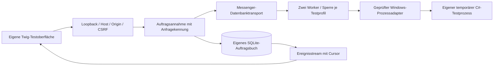

# Symfony-Migration

Am 16.10.2026 hat der Nutzer die Migration freigegeben. Symfony ist ihm vertraut; Lesbarkeit und eigener Review des Anwendungskerns sind Auswahlkriterien. [Epic #45](https://github.com/korvegan/gameserver-indy/issues/45) koordiniert die Schritte. Der erste Durchstich #46 läuft getrennt von der bestehenden Python-Verwaltung. Das bisherige Architekturpapier dokumentiert deren weiterhin produktiven Stand.

## Teilissues und Abgrenzung

| Issue | Umfang | Grundlage |
| --- | --- | --- |
| [#46](https://github.com/korvegan/gameserver-indy/issues/46) | Isolierter Browser-/Auftrags-/Windows-Durchstich | erster Schritt, jetzt beauftragt |
| [#47](https://github.com/korvegan/gameserver-indy/issues/47) | Persönliche Identität, Tailscale, Freigaben, stabile Sitzungen | #46; bestehendes #17 |
| [#48](https://github.com/korvegan/gameserver-indy/issues/48) | Spielkatalog, Profile und exakte Konfigurationsadapter | #46/#47; bestehendes #5 |
| [#49](https://github.com/korvegan/gameserver-indy/issues/49) | Produktive Aufträge und Windows-Steuerung | #46–#48; Betriebsgrenzen #7/#8/#14 |
| [#50](https://github.com/korvegan/gameserver-indy/issues/50) | Bestehende Weltsicherungen und Restore | #48/#49; umgesetztes #6 |
| [#51](https://github.com/korvegan/gameserver-indy/issues/51) | Chronikdaten, Medien und feste Szenenreferenzen | #46/#47; bestehendes #24/#25 |
| [#52](https://github.com/korvegan/gameserver-indy/issues/52) | Vorhandenes Dashboard mit Twig/UX und gezielten Vue-/TypeScript-Komponenten | Fachmodule und #51 |
| [#53](https://github.com/korvegan/gameserver-indy/issues/53) | Bestehende Steam-/Discord-Verträge und Providergrenzen | #47–#49/#51 |
| [#54](https://github.com/korvegan/gameserver-indy/issues/54) | Nativer Betrieb, Release, geplante Umschaltung und Rückweg | abgenommene Fachmigration |

Neue Funktionen aus den vorhandenen Issues bleiben dort beauftragt und abgenommen. Die Migration installiert keine Mods, erkennt keine neuen Errungenschaften und erklärt fehlende Bereitschafts-/Belegungsquellen nicht als vorhanden. Ein C#-Agent und AMP sind nicht Teil des ersten Durchstichs. Die Produktionsumschaltung gehört ausdrücklich zu #54.

## Durchstich #46

Unter `symfony/` liegen ein eigenständiges Symfony-7.4-LTS-Projekt, Composer-Lockfile, Twig-Oberfläche, SQLite-Auftragsbuch, Messenger-Datenbanktransport und eine begrenzte SSE-Anzeige. Alle Symfony-Hauptkomponenten sind auf 7.4 begrenzt; die Sperrdatei hält die geprüften Versionen fest. PHP 8.5 wird lokal und in CI geprüft, das Projekt verlangt mindestens PHP 8.4.



Es gibt ausschließlich `demo-a` und `demo-b`, mit festem Programmnamen `indy-symfony-standin.exe`. Der Simulator verwendet eigene kleine Statusdateien. Der Windows-Modus erzeugt seine eigenen Programme aus `tests/Fixtures/Standin.cs`; er nutzt den bestehenden `scripts/windows-server.ps1` ohne Änderungen. Vollständiger EXE-Pfad und PID entscheiden über die Zuordnung. Ein `ready.pid` und eine vom Testprozess geschriebene `graceful-stop.txt` belegen Bereitschaft bzw. reguläres Ctrl+C ausschließlich dieses Testprogramms.

### Starten

Benötigt werden PHP 8.5 mit PDO SQLite/üblichen Composer-Erweiterungen, Composer 2, Python 3 und FrankenPHP. Node/Playwright sind nur für die Browserprüfung erforderlich. Keine zusätzlichen Datenbank-/Redis-/Containerdienste sind nötig.

```bash
composer install --working-dir=symfony
python3 symfony/tools/run_slice.py
# Optional, ausschließlich in Windows oder WSL mit Windows-PowerShell:
python3 symfony/tools/run_slice.py --driver windows
```

Aufruf: `http://127.0.0.1:18865`. Der Starter akzeptiert nur isolierte Ports 18800–18999; er verändert weder Desktop-Verknüpfung noch Tailscale oder Autostart. `--php`, `--frankenphp` bzw. `SLICE_PHP`/`SLICE_FRANKENPHP` wählen vorhandene Werkzeuge. `--state-dir` wählt einen eigenen Datenordner, standardmäßig `symfony/var/slice`. Ein fehlender Marker wird nur in einem leeren Ordner angelegt. Der Starter bindet ausschließlich Loopback; Caddy-Admin ist deaktiviert, Caddy-Konfigurations-/Speicherdaten liegen ebenfalls im Testdatenordner. Beenden mit Ctrl+C stoppt die gestarteten Web-/Workerprozesse und im Windows-Modus ausschließlich die eigenen Standins.

### Ausführungsvertrag

- `POST /api/jobs` nimmt nur `{server_id, operation, request_id}` an und antwortet mit HTTP 202 und stabiler Auftrags-ID. Dieselbe Anfragekennung mit gleichem Ziel/Befehl gibt denselben Auftrag zurück; eine andere Bedeutung derselben Kennung ist ein Konflikt.
- Auftragsbuch und Messenger-Zustellung werden über dieselbe DBAL-Verbindung atomar gespeichert. Höchstens 16 offene Aufträge insgesamt und acht pro Testprofil. Annahme sperrt nur die kurze Datenbanktransaktion; lange Windows-Aufrufe laufen im Worker.
- Die Worker-Sperre gilt je Profil. Auch eine anders sortierte Messenger-Zustellung führt die offenen Aufträge nach ihrer Datenbanksequenz aus. Ein freier anderer Testserver kann parallel bearbeitet werden.
- Der Seiteneffekt beginnt erst nach dauerhaftem `running`. Eine freie Workersperre bei weiterhin `running` belegt einen verlorenen Worker; betroffener Auftrag und wartende Folgebefehle werden `interrupted`. Fehler/unklare native Antworten unterbrechen wartende Folgebefehle. Keine automatische Wiederholung eines bereits beanspruchten Befehls. Nur eine noch nicht beanspruchte Zustellung darf auf eine belegte Workersperre warten.
- Der SSE-Cursor und die erste Auftragsliste stammen aus demselben SQLite-Snapshot. Verbindungen laufen begrenzt zehn Sekunden und setzen anschließend über `Last-Event-ID` fort. Historische Abschlussereignisse werden beim Neuladen nicht als neue Starts wiedergegeben.
- `data` der Produktionsverwaltung, `manager.local.json`, Spielkonfigurationen, Webhooks und echte Welten werden nie importiert. Die Testschlüsseldatei bleibt privat im eigenen Ordner und erhält den CSRF-Vertrag über Prozessneustarts. Abgewiesene POSTs werden nicht automatisch wiederholt.

### Rechte und noch offene Abnahmen

Dies ist ein lokaler Durchstich, keine neue Familienanmeldung. `SLICE_ROLE=viewer` ist ein nur beim Start festgelegter isolierter Lesermodus für Tests, keine Rolle aus einem Browserheader. Produktiver Identitätsadapter und Freigaberevisionen folgen #47. Die Oberfläche nennt ihren Testbetrieb ausdrücklich.

PHP-/Windows-Dienststart ohne Desktop-Anmeldung, ASKA-DPAPI, echte Welt-Speicherabschlüsse und produktive Profil-/Datenmigration sind hier nicht bestätigt. Auch ein neuer nativer Windows-FrankenPHP-Host wurde mit diesem WSL-Durchstich nicht abgenommen. Datenaufbewahrung, Produktionsbeendigung und Supervisor/Release-Lebenszyklen werden vor dem Cutover in #49/#54 vervollständigt. Ein Durchstich ersetzt diese späteren Abnahmen nicht.

## Prüfungen

```bash
cd symfony
composer validate --strict
composer audit
php bin/console lint:container
php bin/console lint:twig templates
php vendor/bin/phpunit
SLICE_WINDOWS_TEST=1 php vendor/bin/phpunit --filter NativeWindowsFlowTest
cd ..
npm ci --no-audit --no-fund
npm run test:symfony-browser
# In WSL zusätzlich mit echten eigenen Windows-Stellvertretern:
SLICE_BROWSER_DRIVER=windows npm run test:symfony-browser
```

Die PHP-Prüfungen decken HTTP-Grenzen, Leserrolle, Sitzungsfortbestand, begrenzte Queue, FIFO, wiederholte Zustellung, verlorene Worker und atomaren Rollback ab. Die native Prüfung bestätigt den Weg HTTP → Messenger → temporärer Windows-Prozess → regulärer Stopp. Der Browserlauf startet eigene Fixtures auf 18866/18867, prüft reale SSE-Aktualisierung, verzögerten Status, Anwendungsneustart und mobile Ansicht und räumt seine eigenen Standins auf. CI prüft PHP auf Linux/Windows, den nativen Windows-Stellvertreter sowie Chromium. Die bisherigen Python-/Browserprüfungen bleiben erhalten.

## Quellen der Entscheidung

- [Symfony 7.4 LTS und Wartungszeitraum](https://symfony.com/releases/7.4)
- [Messenger und mehrfache Zustellung](https://symfony.com/doc/7.4/messenger.html#writing-idempotent-handlers)
- [Native Symfony-Ereignisstreams](https://symfony.com/doc/7.4/controller.html#streaming-server-sent-events)
- [FrankenPHP einschließlich Windows-Paketen](https://frankenphp.dev/docs/)
- [PCNTL steht unter Windows nicht zur Verfügung](https://www.php.net/manual/en/pcntl.installation.php)
